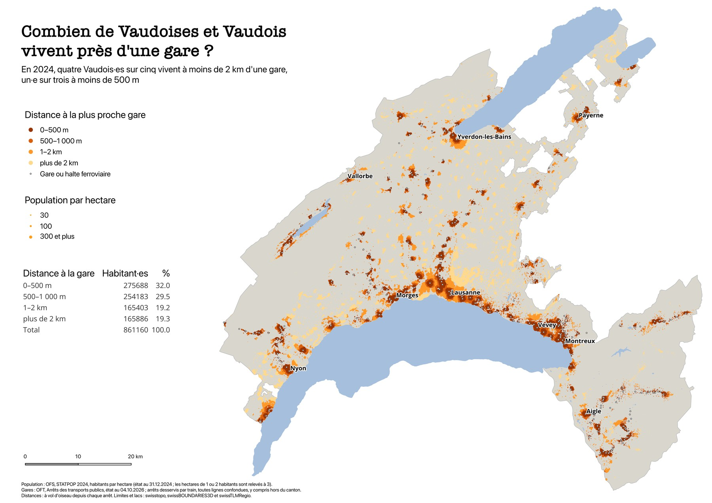
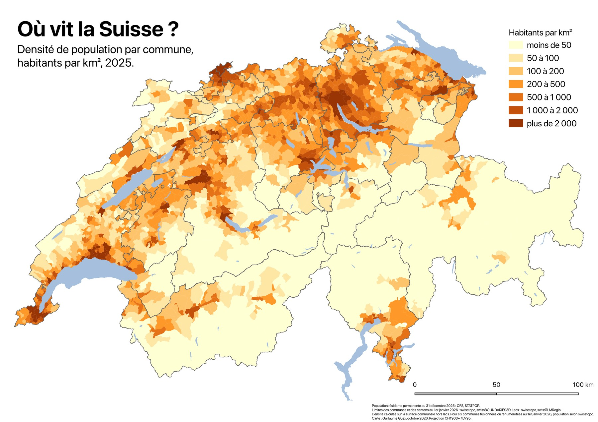
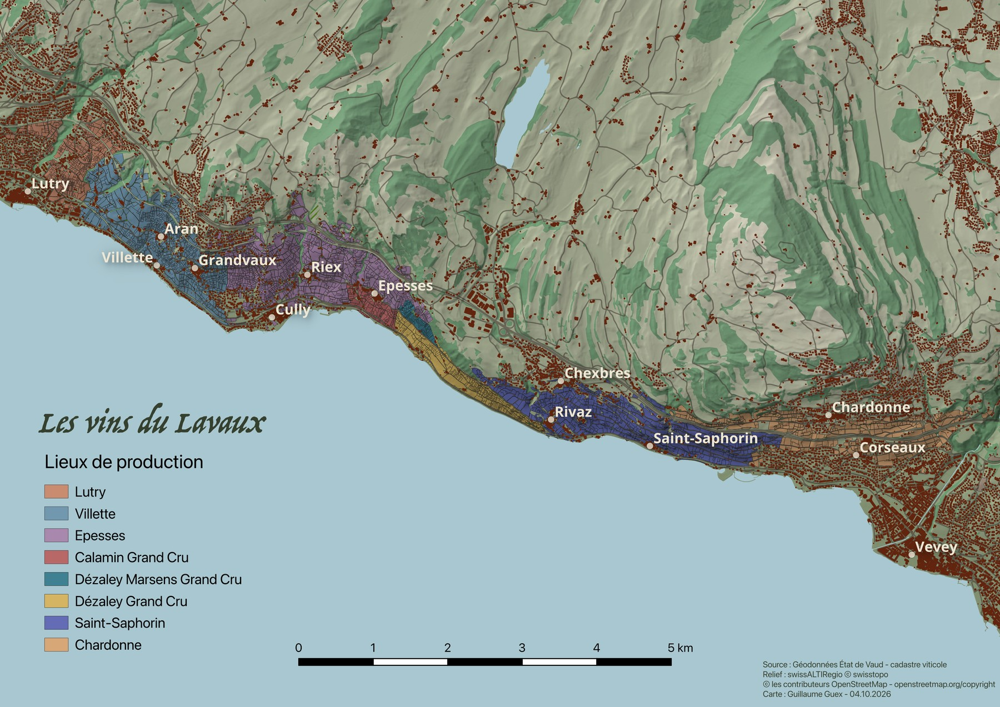
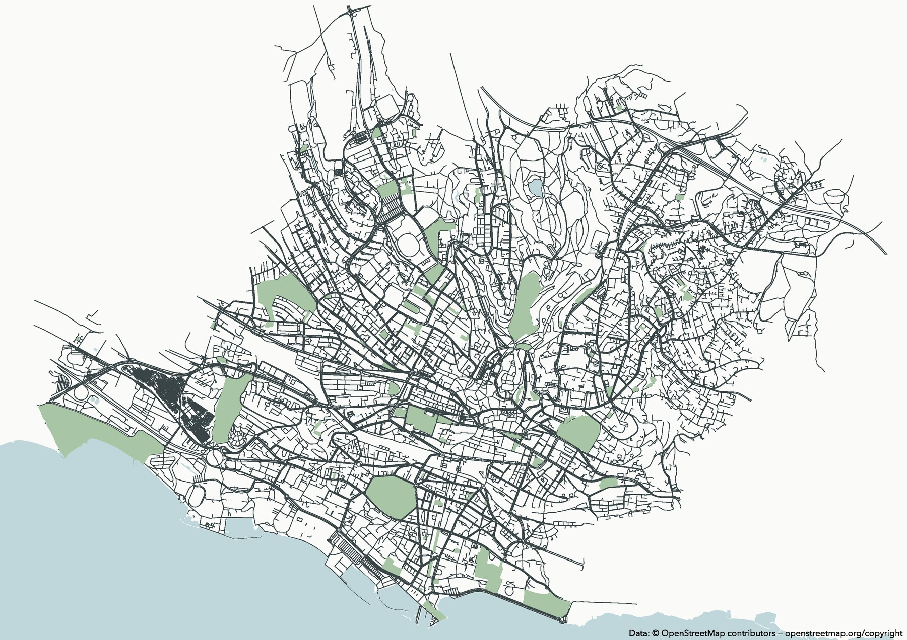

Since autumn 2026 I have been learning cartography with QGIS, one map per project, each built from official Swiss open data and designed for print. This page collects the finished ones, most recent first. The maps are in French. Click a map to open the full-resolution PDF.

::: {.static-map}

## How many people in Vaud live near a railway station?

*13 October 2026 · A3 landscape, 1:300 000*

[{fig-alt="Map of the canton of Vaud with inhabited hectares coloured by distance to the nearest railway station"}](maps/gares_population_vaud.pdf)

Every inhabited hectare of the canton is a dot, coloured by its distance to the nearest railway station or halt and sized by its population. The answer is in the subtitle: in 2024, four out of five people in Vaud lived within 2 km of a station, and one in three within 500 m. The empty areas, Gros-de-Vaud, Broye, Jorat and the side valleys, read in pale yellow.

**Data and method.** Population per hectare from the Federal Statistical Office (STATPOP 2024); public transport stops from the Federal Office of Transport (October 2026), keeping every stop served by a train, including those just outside the canton; boundaries and lakes from swisstopo (swissBOUNDARIES3D, swissTLMRegio). Distances as the crow flies: buffers of 500 m, 1 km and 2 km around all stations, merged, cut into rings and joined spatially to the hectare grid; the table in the legend is computed by a SQL query inside QGIS.

## Where does Switzerland live?

*11 October 2026 · A4 landscape*

[{fig-alt="Choropleth map of Switzerland showing population density per commune in 2025, in seven classes"}](maps/densite_suisse.pdf)

Population density of each of the 2,100 communes in 2025, in inhabitants per km² of land. Densities range from under 1 to over 13,000, a power-law distribution that defeats the usual classifications, so the seven classes use round, geometric breaks (50, 100, 200, 500, 1,000, 2,000) that a reader can remember. Blue is reserved for the lakes, so the data take an ochre ramp, and commune outlines are dropped so that the colour alone speaks.

**Data and method.** Permanent resident population at 31 December 2025 from the Federal Statistical Office (STATPOP), joined by the official commune number to the swisstopo boundaries of 1 January 2026 (swissBOUNDARIES3D); lakes from swissTLMRegio. Density is computed on the commune area minus its lakes. For six communes merged or renumbered at the start of 2026, the swisstopo population figure fills the gap, as stated on the map.

## The wines of Lavaux

*4 October 2026 · A4 landscape*

[{fig-alt="Map of the Lavaux vineyards between Lutry and Vevey, with vineyard parcels coloured by production area over a shaded relief"}](maps/vins_du_lavaux.pdf)

The 5,243 parcels of the Vaud wine cadastre between Lutry and Vevey, each coloured by its production area, from Lutry to Chardonne, with the Dézaley and Calamin grands crus in between. The terraces are set on a shaded relief of the slopes above Lake Léman, with the villages, buildings and paths kept as context and the motorway deliberately faded.

**Data and method.** Vineyard parcels from the geodata of the Canton of Vaud (cadastre viticole); relief from the swisstopo swissALTIRegio elevation model (10 m), rendered as a hillshade with a discrete elevation palette; villages, buildings, roads and paths from OpenStreetMap. Twelve layers in the Swiss projection CH1903+ / LV95.

## Lausanne, minimal

*1 October 2026 · A4 landscape*

[{fig-alt="Minimal map of central Lausanne showing streets, parks and the lake shore on a near-white background"}](maps/lausanne_minimal.pdf)

My first QGIS map, and the simplest: the street network, the parks and the shore of central Lausanne, nothing else. No title, no legend, a near-white background chosen after a test print, and a line weight tuned so that the city's shape and its relation to the lake carry the whole image.

**Data and method.** Streets, water and parks extracted from OpenStreetMap with the QuickOSM plugin, three layers in all. The version shown here carries the OpenStreetMap attribution required for public use.

:::

All maps © Guillaume Guex, made with QGIS. Data remain under the licences of their sources: swisstopo and Federal Statistical Office open data, Canton of Vaud geodata, OpenStreetMap contributors (ODbL).
